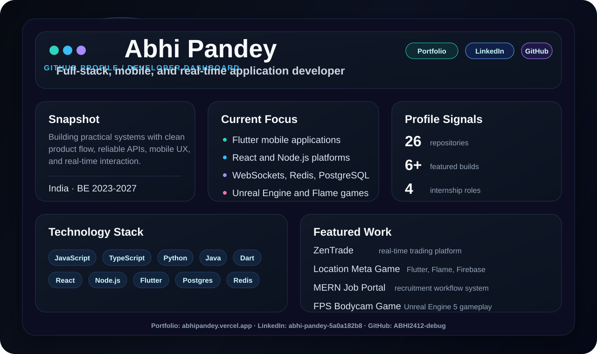

---

## About

I am a full-stack and mobile application developer building practical web, mobile, and game experiences. My work focuses on clean product flows, dependable backend integration, real-time updates, and interactive systems.

**Portfolio:** [abhipandey.vercel.app](https://abhipandey.vercel.app/) 
**LinkedIn:** [abhi-pandey-5a0a182b8](https://www.linkedin.com/in/abhi-pandey-5a0a182b8/) 
**GitHub:** [ABHI2412-debug](https://github.com/ABHI2412-debug)

---

## Technology Stack

---

## Featured Projects

| Project | Focus | Stack |
| --- | --- | --- |
| **ZenTrade** | Real-time trading platform with live market updates, high-frequency candlestick charts, order workflows, and service-oriented backend architecture. | `React` `Node.js` `PostgreSQL` `Redis` `WebSockets` `Docker` |
| **Location-Based Meta Game** | Mobile gameplay experience built around live maps, location-aware mechanics, Firebase auth, and real-time data. | `Flutter` `Dart` `Flame` `Firebase` |
| **MERN Job Portal** | Recruitment platform supporting job discovery, database-backed workflows, REST APIs, and frontend-backend integration. | `MongoDB` `Express.js` `React` `Node.js` |
| **Certificate Verification System** | Certificate creation, management, and verification workflow with backend data handling. | `MongoDB` `Express.js` `React` `Node.js` |
| **FPS Bodycam Game** | First-person bodycam-style gameplay systems, camera behavior, movement, interactions, and team implementation. | `Unreal Engine 5` `Blueprints` |

---

## Experience

| Role | Organization | Work |
| --- | --- | --- |
| **Data Analyst Intern** | Igenie Labs | Cleaned, deduplicated, standardized, and validated bibliographic datasets. |
| **Management & Flutter/Flame Developer Intern** | The Good Game Theory | Built Android and 2D game systems, integrated Firebase, coordinated partnerships, and hosted Drone Decoder Lab with Vedic. |
| **MERN Stack Developer Intern & Team Lead** | Amdox Technology | Built full-stack applications, integrated APIs, and coordinated a five-member development team. |
| **Game Development Intern & Lead Developer** | Godeaon Studios | Developed FPS bodycam gameplay systems in Unreal Engine 5 and mentored eight junior interns. |

---

## Education

**Bachelor of Engineering** 
Ramdeobaba University (RBU) · 2023-2027

---

## GitHub Metrics

