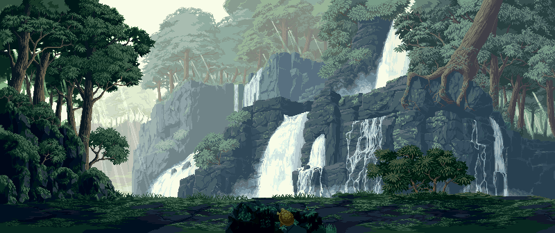
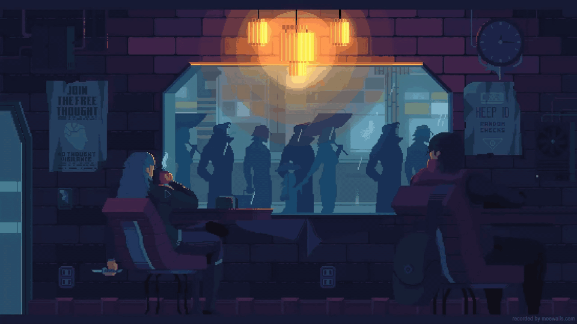

<!-- Master Head -->

  

<!-- Profile Badges -->

  
  
  

 

### About Me

I am **Abhi Pandey**, a software developer focused on mobile apps, full-stack engineering, real-time systems, and interactive game experiences.

- Building cross-platform applications with **Flutter**, **Dart**, and **Firebase**
- Developing full-stack platforms with **React**, **Node.js**, **Express**, and databases
- Exploring real-time systems using **WebSockets**, **Redis**, and **PostgreSQL**
- Creating interactive gameplay systems with **Unreal Engine 5** and **Flame**
- Experienced in data preprocessing, validation, cleaning, and workflow management

### Drop Me A Line

  
  
  

 

---

### Languages & Tools I Have Placed My Hands On

   
   
  

---

### Featured Projects

| Project | What It Does | Stack |
| --- | --- | --- |
| **ZenTrade** | Binance-inspired trading platform with real-time market data, candlestick charts, order workflows, and service-oriented backend design. | `React` `Node.js` `PostgreSQL` `Redis` `WebSockets` `Docker` |
| **Location-Based Meta Game** | Mobile game experience built around real-time maps, location-aware mechanics, authentication, and live data updates. | `Flutter` `Dart` `Flame` `Firebase` |
| **MERN Job Portal** | Recruitment platform for job discovery, hiring workflows, REST APIs, and database-backed application features. | `MongoDB` `Express.js` `React` `Node.js` |
| **Certificate Verification System** | Web app for certificate creation, management, and verification with structured backend workflows. | `MongoDB` `Express.js` `React` `Node.js` |
| **FPS Bodycam Game** | First-person bodycam-style game with movement, camera behavior, interaction systems, and team-led implementation. | `Unreal Engine 5` `Blueprints` |

---

### Professional Experience

| Role | Organization | Highlights |
| --- | --- | --- |
| **Data Analyst Intern** | Igenie Labs | Cleaned, deduplicated, standardized, and validated large bibliographic datasets. |
| **Management & Flutter/Flame Developer Intern** | The Good Game Theory | Built Android apps and 2D game systems, integrated Firebase, coordinated partnerships, and hosted Drone Decoder Lab with Vedic. |
| **MERN Stack Developer Intern & Team Lead** | Amdox Technology | Built full-stack applications, integrated APIs, and coordinated a five-member development team. |
| **Game Development Intern & Lead Developer** | Godeaon Studios | Developed FPS bodycam gameplay systems in Unreal Engine 5 and mentored eight junior interns. |

---

### Tech Stack

  
  
  
  
  
  
  
  
  
  
  
  
  

---

### GitHub Status

  
  

---

### GitHub Metrics Dashboard

  

---

### Education

**Bachelor of Engineering** 
Ramdeobaba University (RBU) · 2023-2027

---

  

  Built with the animated profile style you liked, customized for <strong>Abhi Pandey</strong>.

<!-- profile-verified -->
